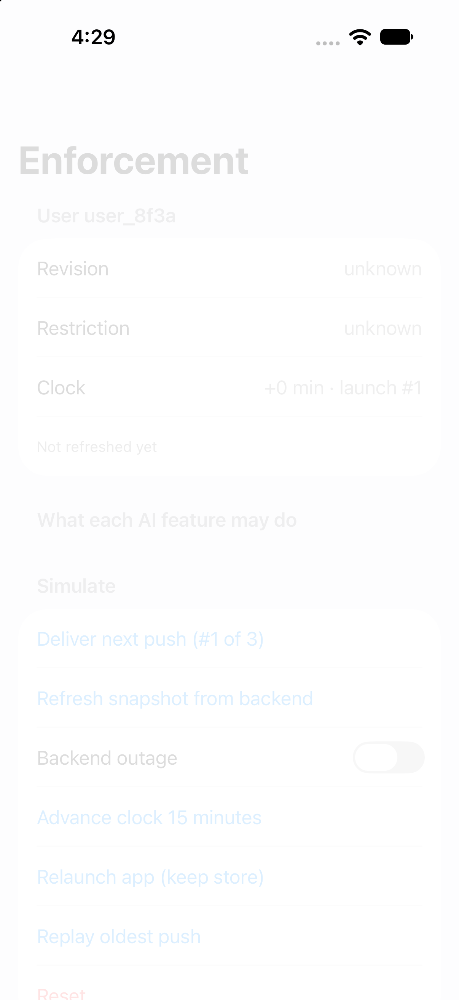
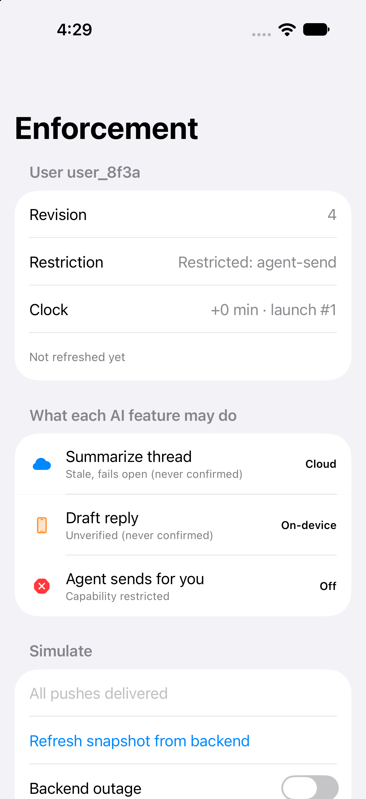
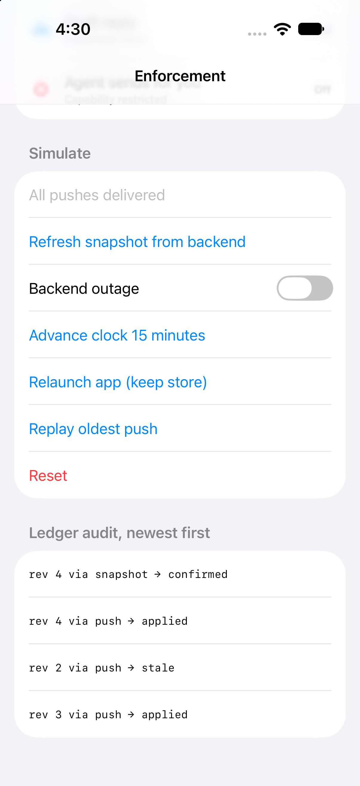
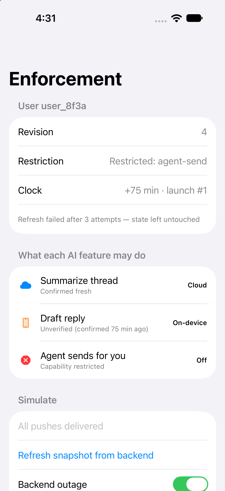

# UserEnforcement Demo

**Watch one user's AI features go from cloud to on-device to off and back, as out-of-order pushes, a backend outage and a relaunch hit the same ledger.**

This is the runnable companion to [`user-enforcement-sync-kit`](https://github.com/rajatslakhina/user-enforcement-sync-kit). It is a separate Xcode project that pulls the library from GitHub as a version-pinned remote Swift package, the way a real app would, rather than from a local path.

## Why this matters

When an AI provider restricts one of your end users, the hard part isn't receiving the news. It's acting on it the same way on every device. Pushes arrive late and out of order, the backend is sometimes down, and the app relaunches between any two events. This console lets you cause each of those things and see what the real `EnforcementLedger`, `EnforcementReconciler` and `EnforcementGate` decide, feature by feature.

## Screenshots

Captured from this app running on an iOS 27.0 Simulator (iPhone 18 Pro), built against `user-enforcement-sync-kit` 1.0.1 resolved from GitHub.

| Launch: user unknown | Pushes 3, 2, 4 delivered | The stale push, in the audit log | Outage after 75 minutes |
|---|---|---|---|
|  |  |  |  |

## What to try

The scenario is compiled into `Demo/DemoApp.swift`. The app owns it and passes it to the library's `EnforcementConsoleView`. It sets up user `user_8f3a` with three AI features:

| Feature | Risk | When it can't confirm the user | Fallback |
|---|---|---|---|
| Summarize thread | `read` | fails open for 24 h | on-device |
| Draft reply | `generate` | fails closed after 1 h | on-device |
| Agent sends for you | `act` | fails closed after 10 min | none (off) |

The backend's timeline: rev 2 pauses agent actions for 20 minutes, rev 3 suspends the user, and rev 4 lifts the suspension but keeps agent actions restricted. APNs delivers the pushes in the order **3, 2, 4**.

1. **Launch.** The user is unknown. Summarize stays on the cloud (it fails open), Draft reply drops to on-device, and the Agent is off. Both show "Unverified (never confirmed)".
2. **Deliver push #1 (rev 3).** The user is suspended, so every feature is on-device or off.
3. **Deliver push #2 (rev 2).** It's older than rev 3, so the audit log shows `rev 2 via push → stale` and nothing changes.
4. **Deliver push #3 (rev 4).** The suspension lifts and the Agent shows "Capability restricted". Draft reply is still on-device, because a push never counts as a confirmation.
5. **Refresh snapshot.** A confirmed rev 4. Summarize and Draft reply go to the cloud, and the Agent stays off.
6. **Advance the clock 15 minutes, five times.** At exactly 60 minutes Draft reply is still on the cloud, because the window is inclusive. At 75 minutes it drops back to on-device ("Unverified (confirmed 75 min ago)"). Summarize stays on the cloud.
7. **Turn on Backend outage, then Refresh.** It reports "Refresh failed after 3 attempts — state left untouched". The ledger keeps what it knew.
8. **Relaunch app (keep store), then Replay oldest push.** The persisted revision floor (4) rejects the replayed rev 2. The persisted confirmation survives too, so the rows still read "confirmed 75 min ago".

These eight steps also run as a test. `DemoWalkthroughTests` in the library replays a mirrored copy of this script against the real ledger, reconciler and gate, and asserts every feature's route and reason text at each step. The console turns off two production defaults so each tap does something visible: retries use fixed 250/500 ms delays instead of full jitter, and the 30-second refresh throttle is off.

## How to run it

1. `git clone https://github.com/rajatslakhina/user-enforcement-sync-demo-app.git`
2. Open `Demo.xcodeproj` in Xcode 16 or later. Xcode resolves `user-enforcement-sync-kit` from GitHub: the project asks for up to next major from 1.0.1, and the committed `Package.resolved` pins 1.0.1.
3. Select the **Demo** scheme and any iOS 17+ Simulator.
4. Build and run (⌘R).

## Verification

- **Ran on a Simulator: yes.** The app was built with `xcodebuild` (Xcode 27.1) against `user-enforcement-sync-kit` 1.0.1 resolved from GitHub, installed and launched with `simctl` on a dedicated iOS 27.0 Simulator (iPhone 18 Pro), and then tapped through all eight steps above plus Reset in Device Hub. Every step showed the routes and text listed above, and the app ran in a single process from launch to the end of the session without crashing. The screenshots above come from that run (`xcrun simctl io … screenshot`). The project was built from the command line; it wasn't opened in the Xcode app.
- **What the Simulator run caught:** an earlier pass against library 1.0.0 showed one wrong line. After "Relaunch app (keep store)" the audit log is empty, and the console said the user was unknown even though the state above it had been restored from the store. That was fixed in library 1.0.1, which this project now requires, and the run above was repeated on 1.0.1.
- **CI:** the [Actions tab](https://github.com/rajatslakhina/user-enforcement-sync-demo-app/actions) runs `xcodebuild -resolvePackageDependencies` and then `xcodebuild build -scheme Demo -destination 'generic/platform=iOS Simulator'` on `macos-15`. That proves the remote package resolves from GitHub and the app compiles against it on a clean machine. This section is updated once it has reported.
- **The library:** 78 tests, including `DemoWalkthroughTests`, which replays this README's eight steps against the real ledger, reconciler and gate.
- **Checked by hand:** `project.pbxproj` has balanced braces and parens, every object id is defined and referenced, a pbxproj parser loads it, and the shared scheme points at the `Demo` target.

## License

MIT
